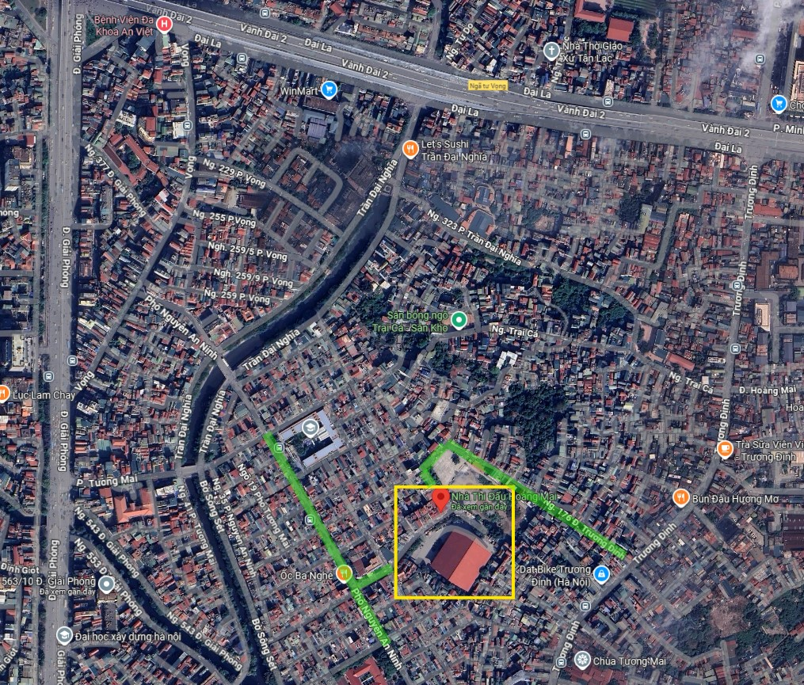
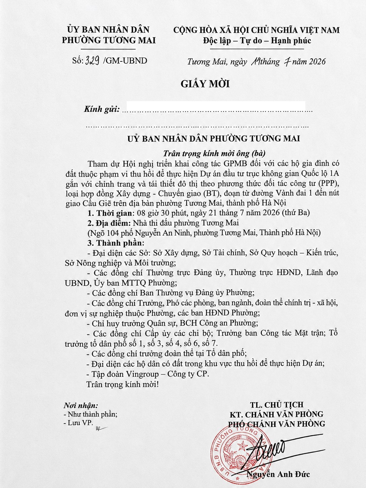

[//]: # (template img )

**Dưới đây là nội dung được trích xuất từ văn bản.**

Tương Mai, ngày 14 tháng 7 năm 2026 GIẤY MỜI Số: 329/GM-UBND

**ỦY BAN NHÂN DÂN PHƯỜNG TƯƠNG MAI**

Trân trọng kính mời ông (bà)

Tham dự Hội nghị triển khai công tác GPMB đối với các hộ gia đình có đất thuộc phạm vi thu hồi để thực hiện Dự án đầu tư trục không gian Quốc lộ 1A gắn với chỉnh trang và tái thiết đô thị theo phương thức đối tác công tư (PPP), loại hợp đồng Xây dựng - Chuyển giao (BT), đoạn từ đường Vành đai 1 đến nút giao Cầu Giẽ trên địa bàn phường Tương Mai, thành phố Hà Nội.

**Thời gian**

08 giờ 30 phút, ngày 21 tháng 7 năm 2026 (thứ Ba).

**Địa điểm**

Nhà thi đấu phường Tương Mai
(Ngõ 104 phố Nguyễn An Ninh, phường Tương Mai, Thành phố Hà Nội)

**Hướng dẫn đi tới địa điểm họp**:
- Đi theo hướng đường Nguyễn An Ninh tới ngõ 104 (chợ) thì rẽ vào, nhà thi đấu nằm bên tay phải
- Đi theo hướng ngõ 176 đường Trương Định, đi hết ngõ, rẽ trái
- Gửi xe tại sân bóng hoặc để ngoài đường tùy tình hình :D

**Thành phần**
- Đại diện các Sở: Sở Xây dựng, Sở Tài chính, Sở Quy hoạch – Kiến trúc, Sở Nông nghiệp và Môi trường;
- Các đồng chí Thường trực Đảng ủy, Thường trực HĐND, Lãnh đạo UBND, Ủy ban MTTQ Phường;
- Các đồng chí Ban Thường vụ Đảng ủy Phường;
- Các đồng chí Trưởng, Phó các phòng, ban ngành, đoàn thể chính trị - xã hội, đơn vị sự nghiệp thuộc Phường, các ban HĐND Phường;
- Chỉ huy trưởng Quân sự, BCH Công an Phường;
- Các đồng chí Cấp ủy các chi bộ; Trưởng ban Công tác Mặt trận; Tổ trưởng tổ dân phố số 1, số 3, số 4, số 6, số 7;
- Các đồng chí trưởng đoàn thể tại Tổ dân phố;
- Đại diện các hộ dân có đất trong khu vực thu hồi để thực hiện Dự án;
- Tập đoàn Vingroup – Công ty CP.

./