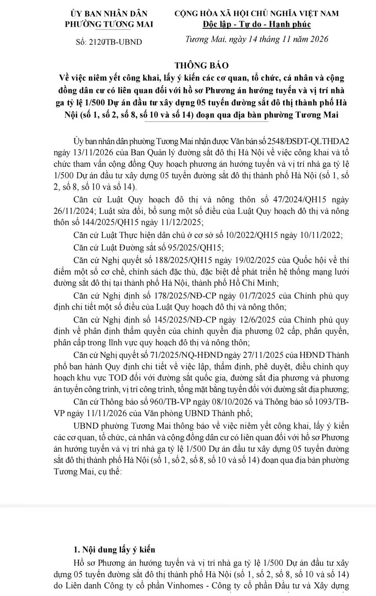
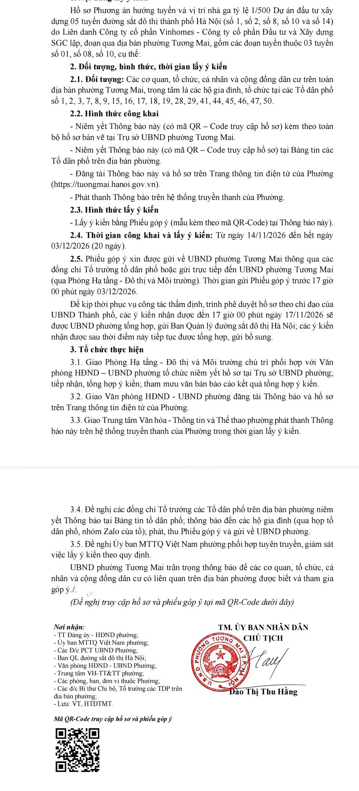
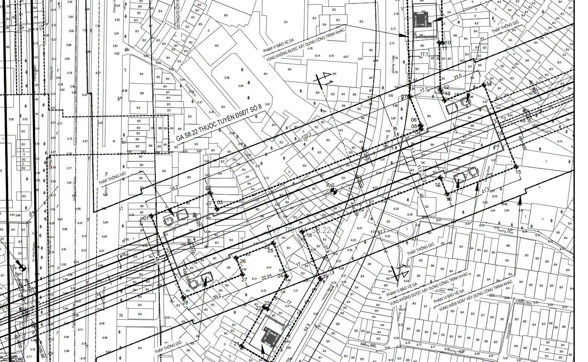
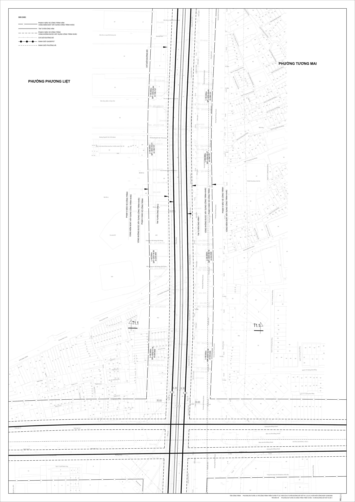
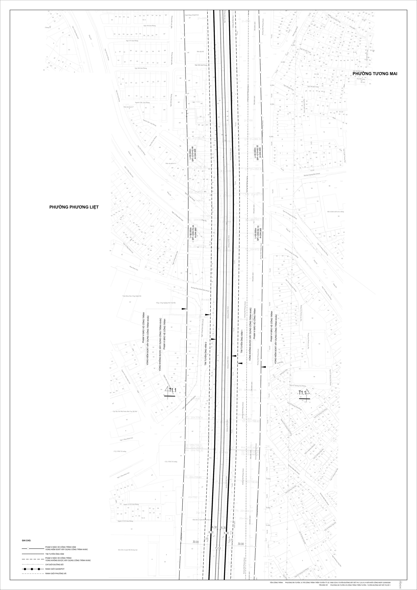
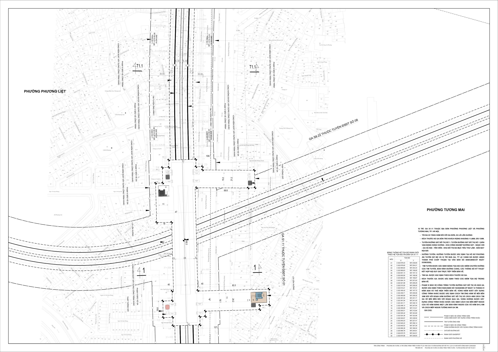
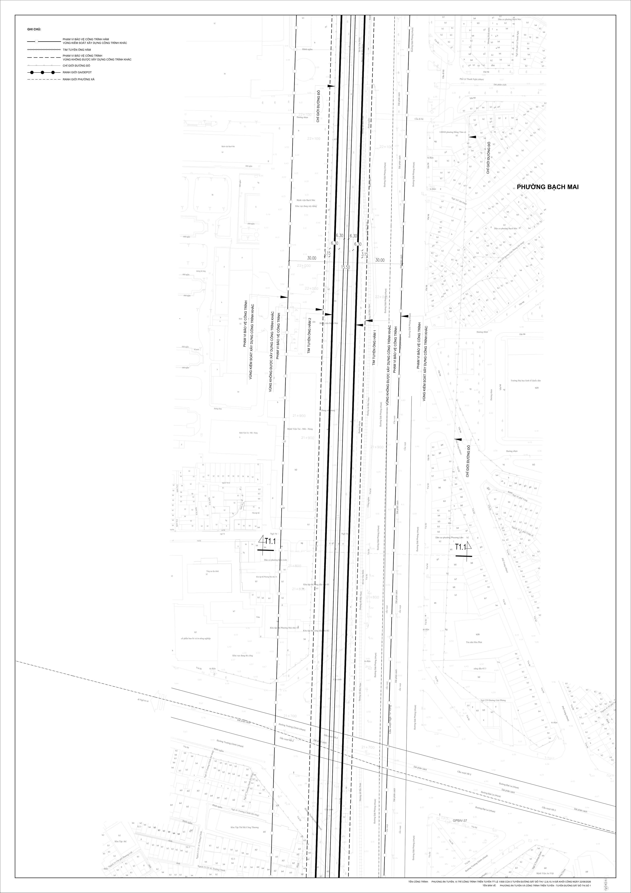

[//]: # (template img )

**Toàn bộ Hồ sơ lấy ý kiến tải tại đây: ** [Link Lay y kien CDDC 13/11](https://drive.google.com/drive/folders/1YaMvpXidep-lBc7w-RVuxubXrRh8D7Z7)

# Tương Mai công khai hồ sơ phương án hướng tuyến và vị trí nhà ga tỷ lệ 1/500

Ngày 14/11/2026, UBND phường Tương Mai ban hành thông báo niêm yết công khai, lấy ý kiến các cơ quan, tổ chức, cá nhân và cộng đồng dân cư có liên quan đối với hồ sơ phương án hướng tuyến và vị trí nhà ga tỷ lệ 1/500 thuộc Dự án đầu tư xây dựng 05 tuyến đường sắt đô thị thành phố Hà Nội, gồm các tuyến số 1, số 2, số 8, số 10 và số 14.

Theo thông báo, phần hồ sơ qua địa bàn phường Tương Mai gồm các đoạn thuộc **03 tuyến: số 01, số 08 và số 10**. Hồ sơ do Liên danh Công ty cổ phần Vinhomes – Công ty cổ phần Đầu tư và Xây dựng SGC lập. Việc công khai được thực hiện trên cơ sở Văn bản số 2548/ĐSĐT-QLTHDA2 ngày 13/11/2026 của Ban Quản lý đường sắt đô thị Hà Nội.

# Thời gian và cách thức tham gia góp ý

**Thời gian công khai, lấy ý kiến: từ ngày 14/11/2026 đến hết ngày 03/12/2026, tổng cộng 20 ngày**. Phiếu góp ý gửi trước **17 giờ ngày 03/12/2026** về UBND phường Tương Mai thông qua Tổ trưởng tổ dân phố, hoặc gửi trực tiếp đến UBND phường qua Phòng Hạ tầng – Đô thị và Môi trường.

Để phục vụ công tác thẩm định, trình phê duyệt, các ý kiến nhận được đến **17 giờ ngày 17/11/2026** được phường tổng hợp gửi Ban Quản lý đường sắt đô thị Hà Nội. Các ý kiến nhận sau thời điểm này tiếp tục được tổng hợp và gửi bổ sung trong thời gian lấy ý kiến.

# Đối tượng và địa điểm công khai hồ sơ

Đối tượng lấy ý kiến là các cơ quan, tổ chức, cá nhân và cộng đồng dân cư trên toàn địa bàn phường. Trọng tâm là các hộ gia đình, tổ chức tại tổ dân phố số **1, 2, 3, 7, 8, 9, 15, 16, 17, 18, 19, 28, 29, 41, 44, 45, 46, 47 và 50**.

Thông báo kèm mã QR truy cập hồ sơ và toàn bộ hồ sơ bản vẽ được niêm yết tại trụ sở UBND phường Tương Mai. Thông báo có mã QR được niêm yết tại bảng tin các tổ dân phố; đồng thời hồ sơ được đăng tải trên Trang thông tin điện tử phường và thông báo qua hệ thống truyền thanh. Việc lấy ý kiến thực hiện bằng phiếu góp ý theo mẫu trong hồ sơ.

# Phạm vi bản vẽ hiển thị trên trang

Tài liệu bản vẽ cung cấp cho bài gồm **04 tờ phương án tuyến và công trình trên tuyến đường sắt đô thị số 1**, thể hiện hành lang dọc đường Giải Phóng, khu vực Kim Đồng – Định Công, vị trí ga S1.11 và các đoạn tuyến liên quan. Đây không phải bộ bản vẽ đầy đủ của cả 05 tuyến đường sắt đô thị.

Trong phạm vi bài viết này chỉ thể thiện **tờ số 3, khu vực ga S1.11 và vị trí giao tuyến số 8**, căn theo bảng tọa độ VN-2000 gồm 30 mốc ranh ga S1.11 trên chính bản vẽ. Bốn tờ bản vẽ được trình bày đầy đủ ở phần dưới để đối chiếu các đoạn tuyến còn lại.

# Thông tin ga S1.11 và các ký hiệu trên bản vẽ

Bản vẽ ghi ga S1.11 thuộc tuyến đường sắt đô thị số 1, nằm trên địa bàn phường Phương Liệt và phường Tương Mai; đồng thời thể hiện ga S8.22 thuộc tuyến đường sắt đô thị số 8. Phần ghi chú của tờ ga nêu phương án tối đa 03 tầng hầm đối với ga đơn, 02 lối lên xuống; ke ga đón trả khách rộng khoảng 11,86 m, dài 130 m.

Các lớp nét trên hồ sơ phân biệt tim tuyến ống hầm, ranh giới ga/depot, chỉ giới đường đỏ, phạm vi bảo vệ công trình hầm, vùng không được xây dựng công trình khác, vùng kiểm soát xây dựng và ranh giới phường, xã. Vị trí và kích thước cụ thể cần đọc cùng bảng tọa độ, kích thước ghi trên bản vẽ và hồ sơ được cơ quan có thẩm quyền xác nhận.

# Tổ chức tiếp nhận và tổng hợp ý kiến

Phòng Hạ tầng – Đô thị và Môi trường chủ trì niêm yết hồ sơ, tiếp nhận và tổng hợp ý kiến. Văn phòng HĐND – UBND phường đăng tải thông báo, hồ sơ; Trung tâm Văn hóa – Thông tin và Thể thao phường thực hiện phát thanh. Tổ trưởng các tổ dân phố thông báo đến hộ gia đình, phát và thu phiếu góp ý; Ủy ban MTTQ Việt Nam phường phối hợp tuyên truyền và giám sát việc lấy ý kiến.

# Bốn tờ bản vẽ phương án tuyến số 1

*Tờ 1 – Phương án tuyến và công trình trên tuyến số 1.*

*Tờ 2 – Phương án tuyến và công trình trên tuyến số 1.*

*Tờ 3 – Phương án tuyến và công trình trên tuyến số 1.*

*Tờ 4 – Phương án tuyến và công trình trên tuyến số 1.*

*Nguồn nội dung: Thông báo của UBND phường Tương Mai ngày 14/11/2026 và bộ bản vẽ phương án tuyến số 1 kèm hồ sơ lấy ý kiến.*

./